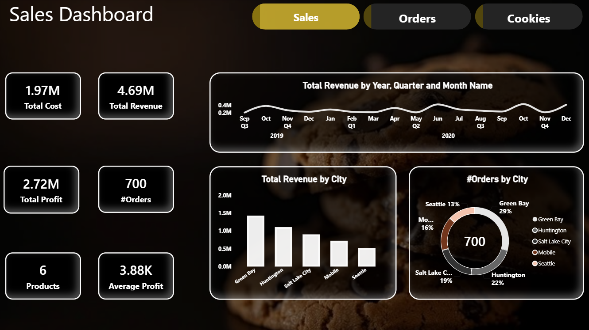
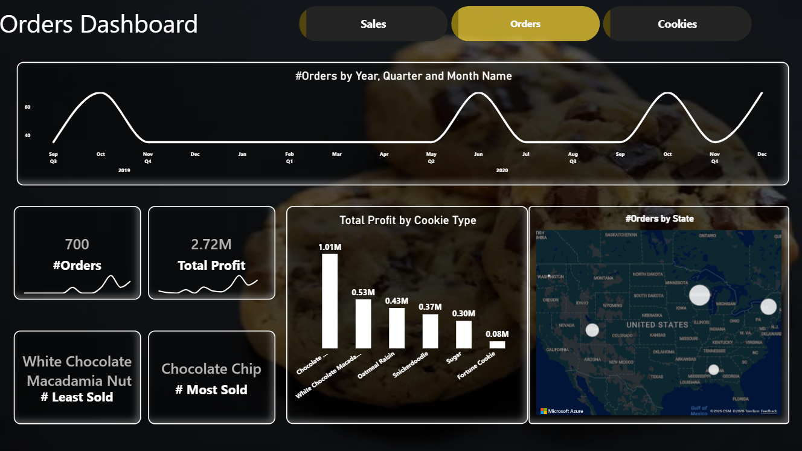
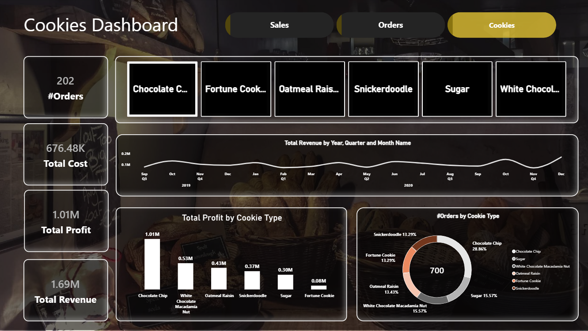

# Cookie Sales Analysis

An interactive **Power BI** dashboard that analyzes cookie sales, orders and profitability across cities and cookie types from **September 2019 to December 2020**. The report has three linked pages (Sales, Orders and Cookies) with navigation buttons and a dark, bakery-inspired theme.

---

## Table of Contents
- [Overview](#overview)
- [Key Metrics](#key-metrics)
- [Dashboard Pages](#dashboard-pages)
- [Screenshots](#screenshots)
- [Key Insights](#key-insights)
- [Tech Stack](#tech-stack)

---

## Overview

The dashboard helps answer questions such as:

- How much revenue, cost and profit does the business generate?
- Which cookie types sell the most and earn the highest profit?
- Which cities and states bring in the most revenue and orders?
- How do revenue and orders change over time?

---

## Key Metrics

| Metric | Value |
|---|---|
| Total Revenue | 4.69M |
| Total Cost | 1.97M |
| Total Profit | 2.72M |
| Number of Orders | 700 |
| Products | 6 cookie types |
| Average Profit | 3.88K |
| Period | Sep 2019 – Dec 2020 |

---

## Dashboard Pages

### 1. Sales
Overall financial performance.
- KPI cards: total cost, total revenue, total profit, number of orders, products, average profit
- Line chart: total revenue by year, quarter and month
- Bar chart: total revenue by city
- Donut chart: number of orders by city

### 2. Orders
Order volume and geography.
- Line chart: number of orders by year, quarter and month
- KPI cards: number of orders and total profit with trend sparklines
- Cards for the most sold and least sold cookie
- Bar chart: total profit by cookie type
- Map: number of orders by state

### 3. Cookies
Product-level analysis with a cookie-type selector.
- Slicer buttons for each cookie type (Chocolate Chip, Fortune Cookie, Oatmeal Raisin, Snickerdoodle, Sugar, White Chocolate Macadamia Nut)
- KPI cards: orders, total cost, total profit, total revenue
- Line chart: total revenue over time
- Bar chart: total profit by cookie type
- Donut chart: share of orders by cookie type

---

## Screenshots

### Sales

### Orders

### Cookies

---

## Key Insights

- **Chocolate Chip** is the best seller, with about 29% of all orders and 1.01M in profit (the highest of any cookie).
- **White Chocolate Macadamia Nut** has the fewest orders, while **Fortune Cookie** earns the lowest profit (0.08M).
- **Green Bay** leads in both revenue and orders (about 29% of orders), followed by Huntington, Salt Lake City, Mobile and Seattle.
- Orders and revenue show **recurring peaks** (for example October and June), which suggests seasonal demand.
- Overall profit is about **58% of revenue** (2.72M of 4.69M).

---

## Tech Stack

- **Power BI Desktop**
- **DAX** for measures (revenue, cost, profit, order counts, most/least sold)
- **Power Query** for data cleaning and shaping
- **Date table** for year, quarter and month analysis
